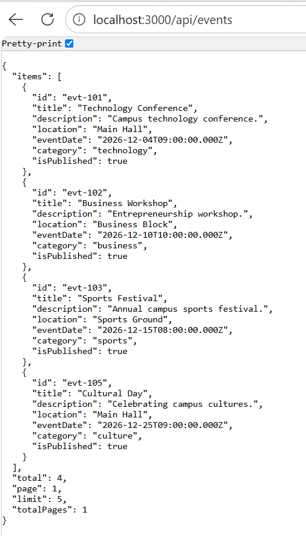
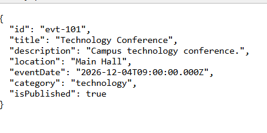
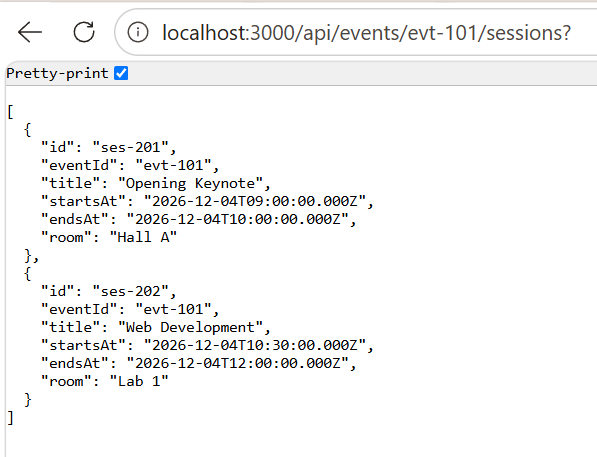
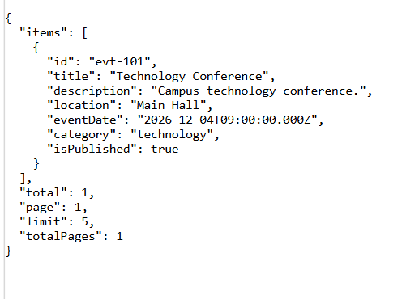

# Campus Events API

A RESTful backend API for managing campus events and their associated sessions. Built with **NestJS**, **TypeScript**, and **Node.js**, following a modular architecture.

## Project Overview

The Campus Events API provides backend functionality for managing campus events and their sessions. It allows clients to retrieve event information, manage event records, and access sessions associated with individual events.

## Technologies Used

- **Node.js** – JavaScript runtime environment
- **NestJS** – Backend application framework
- **TypeScript** – Strongly typed programming language
- **REST API** – HTTP-based API architecture
- **npm** – Package management
- **Jest** – Unit and end-to-end testing

## Features

- Event management
- Event session management
- RESTful API endpoints
- Create, read, update, and delete event operations
- Retrieve sessions belonging to a specific event
- DTO-based request structure
- Modular and maintainable backend architecture
- Unit and end-to-end tests

## Getting Started

### 1. Clone the repository

```bash
git clone https://github.com/aytenew1221/CodeOps-Portfolios.git
```

### 2. Navigate to the backend project

```bash
cd CodeOps-Portfolios/practice/campus-events-api
```

### 3. Install dependencies

```bash
npm install
```

### 4. Start the development server

```bash
npm run start:dev
```

The API runs at:

```text
http://localhost:3000
```

## API Endpoints

Base URL:

```text
http://localhost:3000/api
```

### Events

| Method | Endpoint      | Description       |
| ------ | ------------- | ----------------- |
| GET    | `/events`     | Retrieve events   |
| GET    | `/events/:id` | Retrieve an event |
| POST   | `/events`     | Create an event   |
| PATCH  | `/events/:id` | Update an event   |
| DELETE | `/events/:id` | Delete an event   |

### Event Sessions

| Method | Endpoint                    | Description                    |
| ------ | --------------------------- | ------------------------------ |
| GET    | `/events/:eventId/sessions` | Retrieve sessions for an event |

Example request:

```http
GET /api/events/evt-101/sessions
```

## Running Tests

Run unit tests:

```bash
npm run test
```

Run end-to-end tests:

```bash
npm run test:e2e
```

Run test coverage:

```bash
npm run test:cov
```

## Development Branch

This project is maintained in the `backend` branch of the CodeOps-Portfolios repository.

```bash
git checkout backend
```

## Future Improvements

- Database integration with PostgreSQL
- User authentication and authorization
- Event registration and booking
- Session registration
- Pagination and advanced filtering
- API documentation using Swagger
- Improved error handling and validation

## Author

**Aytenew Ayele**

- GitHub: [@aytenew1221](https://github.com/aytenew1221)
- Repository: [CodeOps-Portfolios](https://github.com/aytenew1221/CodeOps-Portfolios)

## License

This project is developed for educational and portfolio purposes.

## API Screenshots

### 1. API Welcome Endpoint


### 2. All Events



### 3. Event Details



### 4. Event Sessions



### 5. Event Filtering


